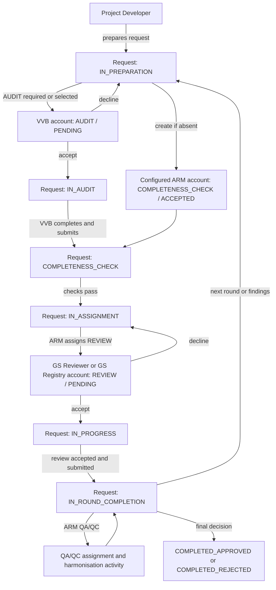

# Request account assignments and review workflow

## Scope and terminology

This explainer follows `gs.request_account_assignment` through request preparation, VVB audit, ARM completeness and QA/QC work, and review by an account associated with a GS Reviewer or GS Registry user. Here, ROE means **Roster of Experts**.

“Review stage” can refer to three different records in this application:

- **Request status**: the overall request state, such as `IN_PREPARATION`, `IN_AUDIT`, `COMPLETENESS_CHECK`, `IN_ASSIGNMENT`, `IN_PROGRESS`, and `IN_ROUND_COMPLETION`.
- **Assignment**: the account responsible for a category of work on a request. It has its own assignment type and assignment status.
- **Request activity**: a pathway task with a planned end date and completion date, such as a review conclusion or harmonisation of feedback.

These are related but not interchangeable. An assignment identifies the work owner; the request status describes the broader workflow state; activities represent dated tasks.

## Assignment data model

`RequestAccountAssignment` links a request ID, an account, an assignment type, and an assignment status. The database table also records created/updated times and an optional due date. Its primary key is the combination of request, account, and assignment type, so one request can have separate assignments for different accounts and kinds of work.

The principal assignment types are:

| Type | ID | Typical owner and role in workflow |
| --- | ---: | --- |
| `AUDIT` | 0 | VVB account performs external validation/verification audit. |
| `REVIEW` | 1 | Account used by a GS Reviewer or GS Registry user for a review round. This is the assignment surfaced in ROE review summaries. |
| `QA/QC` | 2 | ARM/QAQC work, including feedback harmonisation in round completion. |
| `COLLECT_FEE` | 3 | Finance-related task. |
| `COMPLETENESS_CHECK` | 4 | ARM team account performs the completeness check. The backend selects the configured ARM account. |
| `STAKEHOLDER_CONSULTATION` | 5 | Account assignment for consultation work. |

Assignment status is a separate lifecycle: `PENDING`, `ACCEPTED`, or `CANCELLED`. “Accepted” is the current status name; historical migration changed the former `ASSIGNED` label to `ACCEPTED`.

## How assignments, activities, and status notifications route work

These three mechanisms complement one another. `request_account_assignment` records who owns a work category, `request_activity` records which dated task is currently actionable and its responsible account, and `request_status_assignee_notification` selects a message template for assigned accounts when a request changes status.

| Record | Routing information | What it does |
| --- | --- | --- |
| `request_account_assignment` | Request + account + assignment type + assignment status | Associates a request with a VVB, reviewer/registry, ARM, or other work account. Assignment access and acceptance operate on this association. |
| `request_activity` | Request + activity + `responsible_account_id` + start/planned-end/end dates | Creates a pathway task for an account. The creator derives its responsible account from the activity's account type and the request's assignments. |
| `request_status_assignee_notification` | Request status transition configuration + assignment type + notification template | Adds a transition email for every account assigned to the configured assignment type on that request. It does not create or change an assignment. |

When a request status changes, `RequestNotificationService` finds notification configuration by from-status, to-status, and review-round range. The transition configuration can send separate templates to the project owner, ARM team, Registry team, stakeholders, VVB, and finance. Its related `request_status_assignee_notification` rows add assignee-targeted templates: for each configured assignment type, the service loads the accounts assigned that type on the request and sends the template to those accounts. The email recipient is an account contact address (subject to contact mapping), so this path targets an account, not a named person within that account.

When activities are created, `RequestActivityCreator` chooses the responsible account from the activity's account type:

- reviewer activities use the latest account assigned with type `REVIEW`;
- ARM activities use the latest `QA/QC` account, falling back to the configured ARM team account;
- other activity account types default to the configured ARM team account.

The activity therefore follows the account routing established by the assignment where applicable. Assignments also drive account-scoped visibility and role permissions; an activity's responsible account marks task responsibility, but does not itself create a new assignment or grant a named user access. Users act through their account membership and application role. `RequestActivityCompleter` currently permits direct completion only for completeness-check assignment activities; most other activity progress is tied to request status forms and workflow logic.

In short: assignment chooses the work account; activity generation places a concrete task with the appropriate account; transition notification configuration tells the assigned account when the request reaches a configured status transition.

## Step-by-step workflow

### 1. Project Developer prepares and submits

The request is created in `IN_PREPARATION`. A Project Developer can prepare the request and, through the preparation status form, select a VVB account for an `AUDIT` assignment when audit is required or chosen. The form creates that assignment as `PENDING`.

The form also creates the `COMPLETENESS_CHECK` assignment for the configured ARM team account when a completeness assignment does not already exist. That assignment is created as `ACCEPTED`. The submitted account ID is ignored for this assignment type; `AssignmentFactory` uses the configured ARM team account ID.

The form then selects the next request status based on the request type's audit assignment rule and the user's optional audit choice: usually `IN_AUDIT` when audit is required/requested, otherwise `COMPLETENESS_CHECK`. The assignment records and status update are separate API operations, issued together by the UI.

### 2. VVB accepts and completes audit

The VVB assignment is account scoped: the row stores the VVB account, not an individual VVB user ID. Users authorized through that account can see the assignment. A VVB user sees accept/decline controls for a pending `AUDIT` assignment while the request is in `IN_AUDIT`.

Accepting changes the assignment status to `ACCEPTED`. The VVB works on the request while it remains in `IN_AUDIT`; submitting the request through that status form generally advances it to `COMPLETENESS_CHECK`. Declining the audit assignment returns the request to `IN_PREPARATION` and refreshes the assignment view.

### 3. ARM performs completeness work

The `COMPLETENESS_CHECK` assignment belongs to the ARM team. The ARM status form evaluates required documents using the request type's document mappings and then allows the workflow to progress when its checks are satisfied. Moving from `COMPLETENESS_CHECK` to `IN_ASSIGNMENT` can also trigger sales-order creation.

The ARM team is also the coordinator for assignments: Admin and ARM roles can create or update assignments. The backend assigns completeness tasks to the configured ARM account and may notify the assigned account according to the assignment type/status notification mapping.

### 4. ARM routes review to a reviewer or GS Registry account

In `IN_ASSIGNMENT`, the ARM team manages assignment rows. The status form asks whether everything has been assigned, checks the request type's `REVIEW` rule, and requires a reviewer or registry account before allowing submission when review is required or selected. It then moves the request to `IN_PROGRESS` when the request type requires review (or the user chooses review for an optional type). If review is not required or selected, it can move to `IN_ROUND_COMPLETION`.

The `REVIEW` assignment is attached to an account. A user with the GS Reviewer or GS Registry role can accept or decline a pending review assignment when associated with that account. Declining sends the request back to `IN_ASSIGNMENT`; accepting enables the assigned user to submit review work while the request is `IN_PROGRESS`.

ROE (Roster of Experts) is represented operationally by this reviewer assignment and its ROE summary. There is no separate “assign to ROE” assignment type or ROE workflow state. The ARM team chooses the target account; the summary reports review assignments and their request/activity progress.

### 5. Review completion and ARM QA/QC

The review form requires the review assignment to be `ACCEPTED` before the assigned reviewer can submit the round as complete. The request then moves to `IN_ROUND_COMPLETION`. Activities in the selected pathway can include reviewer conclusion tasks and ARM harmonisation of feedback. The ARM summary identifies QA/QC harmonisation work using the `QA/QC` assignment together with request status and activity data.

After round completion, the request may return to preparation/audit/assignment/progress for further work, or reach an approved/rejected terminal status. Assignment rows persist as their own records; changing request status does not itself mean every assignment status changes.

## Mermaid workflow diagram



The diagram shows the common path. Assignment creation and request status updates are separate writes, and request type rules can omit optional assignments or alter the selected route.

## Is there a connection to review stages and request types?

Yes. The connection is through configuration and workflow policy rather than a single direct assignment-to-status relation.

1. `request_type_assignment_type` maps each request type to assignment types and marks them mandatory or optional. The mapping is served by `GET /request-type-assignment-types/{requestTypeId}`. The UI uses it to decide whether audit/review is required and to choose status form behavior.
2. `request_status_transition` configures allowed request status changes by current status and next status. It is not keyed by request type.
3. Pathway selection uses request properties including request type, internal/external flag, fast-track state, and in some cases whether an `AUDIT` assignment exists. The selected pathway determines which activities are generated.
4. Assignment status controls acceptance and assignment-side permissions. Request status controls which role can submit the broader request form. Activity completion controls progression through pathway tasks.

For example, the seed mapping marks audit mandatory for many certification and real-case VPA request types, optional for regular-case VPA, and not required for preliminary review. Review is optional for preliminary review, mandatory for many other types, and optional for generic requests. These mappings shape the UI path, but the request type/assignment type rule is not revalidated by `AssignmentService` on every assignment write.

Pathway selection has another request-type dependency: `PathwayIndexCalculator` selects pathways by request type and internal/external status, and inclusion of regular-case VPA can depend on whether an audit assignment exists. This means assignment presence can influence the activity sequence even though assignment type does not define the request status transition graph.

## API and implementation flow

Assignment create or update:

```text
POST /assignments or PUT /assignments/{assignmentId}
  -> AssignmentController
  -> AssignmentFacade
  -> AssignmentService
  -> AssignmentPermissionsService.validateCanAssignToRequest
  -> BatchRequestChildValidator
  -> AssignmentFactory
  -> RequestAccountAssignmentRepository.save
  -> optional assignment notification
```

Assignment status update:

```text
PUT /assignments/{assignmentId}/status
  -> AssignmentController
  -> AssignmentService.updateAssignmentStatus
  -> AssignmentPermissionsService.validateCanUpdateStatus
  -> repository.updateAssignmentStatus
```

Request assignments are read through `GET /requests/{requestId}/assignments`; account assignment lists are available through `GET /assignments/account/{accountId}`. Request status changes use `PUT /projects/{projectId}/requests`.

## Successful output and side effects

- Assignment writes associate the request with the target account and assignment type, and can send an assignment notification when a matching notification configuration exists.
- Assignment status updates persist independently of request status updates.
- Assigned-request views and ROE/ARM summaries reflect assignment, request status, and activity records on subsequent reads.
- Pathway activity generation follows the request status change and can select different activities based on request type, internal/external state, fast-track state, rounds, and existing audit assignment.

## Handled failures and restrictions

- Assignment creation/update requires an authorized assigner: Admin and ARM can assign generally; a Project Developer can assign only for a project account they own.
- Batch child requests cannot be assigned or updated directly.
- Reviewer, registry, and VVB users can update assignment status only when associated with the assigned account and when the assignment's current status is `PENDING`. Finance has broader assignment status permission.
- Request update actions are constrained by user role and request status in the UI; for example, PD submits during `IN_PREPARATION`, VVB during `IN_AUDIT`, reviewer/registry during `IN_PROGRESS`, and ARM during completeness, assignment, and round completion states.
- The completeness assignment is always directed to the configured ARM account by the backend.

## Unhandled or notable issues

- **Medium — request type assignment rules are not enforced on assignment writes.** The UI uses the rules to guide assignment creation, but the service does not reject an assignment type merely because it is absent or optional in the request type mapping.
- **Medium — VVB assignment is account-level.** The assignment model does not target an individual VVB user; authorized members of the assigned account share access.
- **Low — summaries are projections, not workflow controllers.** ROE and ARM summary endpoints count work from existing assignments, statuses, and activities. They do not create assignments or advance requests.

## Source references

- `back-end/src/main/java/org/goldstandard/assurance/api/entity/RequestAccountAssignment.java`
- `back-end/src/main/java/org/goldstandard/assurance/api/entity/activity/RequestActivity.java`
- `back-end/src/main/java/org/goldstandard/assurance/api/entity/notification/RequestStatusAssigneeNotification.java`
- `back-end/src/main/java/org/goldstandard/assurance/api/entity/notification/RequestStatusNotification.java`
- `back-end/src/main/java/org/goldstandard/assurance/api/service/AssignmentFactory.java`
- `back-end/src/main/java/org/goldstandard/assurance/api/service/AssignmentService.java`
- `back-end/src/main/java/org/goldstandard/assurance/api/service/AssignmentPermissionsService.java`
- `back-end/src/main/java/org/goldstandard/assurance/api/service/activity/RequestActivityCreator.java`
- `back-end/src/main/java/org/goldstandard/assurance/api/service/activity/RequestActivityCompleter.java`
- `back-end/src/main/java/org/goldstandard/assurance/api/service/notification/RequestNotificationService.java`
- `back-end/src/main/java/org/goldstandard/assurance/api/repository/notification/RequestStatusNotificationRepository.java`
- `back-end/src/main/java/org/goldstandard/assurance/api/service/notification/NotificationService.java`
- `back-end/src/main/java/org/goldstandard/assurance/api/service/RequestTypeAssignmentTypeService.java`
- `back-end/src/main/java/org/goldstandard/assurance/api/service/activity/PathwayIndexCalculator.java`
- `back-end/src/main/java/org/goldstandard/assurance/api/service/activity/ActivityPathwayPolicy.java`
- `back-end/src/main/java/org/goldstandard/assurance/api/controller/AssignmentController.java`
- `back-end/src/main/java/org/goldstandard/assurance/api/controller/RequestAssignmentController.java`
- `front-end/src/components/requests/status-change/InPreparationStatusForm.tsx`
- `front-end/src/components/requests/status-change/InAssignmentStatusForm.tsx`
- `front-end/src/components/requests/status-change/InProgressStatusForm.tsx`
- `front-end/src/components/requests/actions/assignments/AcceptDeclineAction.tsx`
- `front-end/src/components/requests/actions/Actions.tsx`
- `data-migration/migrations/000260-assignments-table.sql`
- `data-migration/migrations/001980-create-activities-tables.sql`
- `data-migration/migrations/001120-multi-template-per-request-status-notification.sql`
- `data-migration/migrations/000790-request-type-assignment-type-mapping.sql`
- `docs/features/roe-role-workflow-explainer/README.md`
