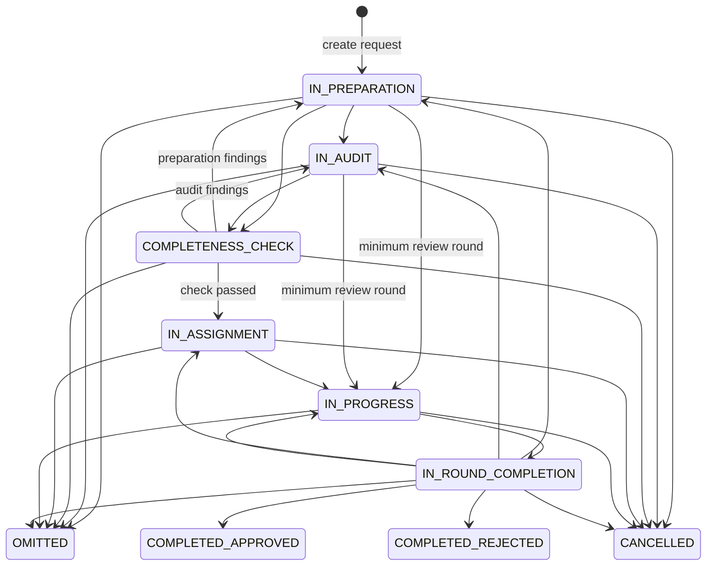

# Request status workflow

## Scope

This document describes the implementation of `Request.currentRequestStatus`, the configured status transition graph, and the request update path. It focuses on the flow from `IN_PREPARATION` through `IN_AUDIT` and `COMPLETENESS_CHECK`, while showing adjacent states that explain how requests can return to those states.

## How the current `request_status` is determined

The current status is stored as `gs.request.current_request_status_id`, a foreign key to `gs.request_status`. The row supplies the status code and description returned by the request API. In Java, this relationship is `Request.currentRequestStatus` (`ManyToOne`). The database maintains `last_request_status_change_date` and appends a row to `request_status_history` when the status ID changes.

New requests start in `IN_PREPARATION` (ID `6`). `RequestFactory` sets this value; the create DTO does not choose the initial status.

For an update, the client submits `requestStatusId` to `PUT /projects/{projectId}/requests`. The backend path is:

```text
PUT /projects/{projectId}/requests
  -> RequestFacade.updateRequest
  -> RequestUpdater.update
  -> RequestUpdateValidator.validate
  -> RequestUpdateApplier.applyParentUpdates
  -> set currentRequestStatus from requestStatusId
  -> UpdateRequestTransaction.updateRequest
  -> requestRepository.save
```

The submitted ID becomes the request's current status. The update still checks project or assignment access, and a batch child cannot set its own status. The general backend update validator does not check the transition table before saving. The database foreign key ensures the status exists; configured transition metadata is returned to the client to guide status forms.

`GET /request-status/{requestStatusId}` returns the permitted next status IDs, each transition's minimum review round and consultation rule, and the account types associated with the current status and their `canProgress` setting. The front end calls this through `getAvailableRequestStatusTransitions`.

## Statuses in the workflow

| ID | Code | Role |
| --- | --- | --- |
| 6 | `IN_PREPARATION` | Request preparation. |
| 11 | `IN_AUDIT` | Audit work. |
| 9 | `COMPLETENESS_CHECK` | Gold Standard completeness check. |
| 12 | `IN_ASSIGNMENT` | Assigning the next review work. |
| 10 | `IN_PROGRESS` | Review round underway. |
| 13 | `IN_ROUND_COMPLETION` | Completing the current review round. |
| 4 / 5 | `COMPLETED_APPROVED` / `COMPLETED_REJECTED` | Terminal outcomes. |

The status IDs and names are represented in `RequestStatus` and seeded in `000040-reference-data.sql`. The configured transition graph is introduced by `000800-permitted-request-status-transitions.sql`.

## Step-by-step flow

### 1. `IN_PREPARATION`

Request creation sets status ID `6`. The configured graph permits a move to `IN_AUDIT`, `COMPLETENESS_CHECK`, `IN_PROGRESS` (subject to the configured minimum review round), `OMITTED`, or `CANCELLED`.

Request type affects the preparation requirements, including document types and request specific fields. It does not change the status ID.

### 2. `IN_AUDIT`

The update sets status ID `11`. The configured next statuses are `COMPLETENESS_CHECK`, `IN_PROGRESS` (subject to its minimum review round), `OMITTED`, and `CANCELLED`.

The request type's assignment mapping determines whether an `AUDIT` assignment is mandatory or optional. That mapping affects the work associated with a status, not the status graph itself.

### 3. `COMPLETENESS_CHECK`

The update sets status ID `9`. From here, the configured graph permits a return to `IN_PREPARATION` or `IN_AUDIT` for findings, a move to `IN_ASSIGNMENT` when the check passes, or a move to `OMITTED` or `CANCELLED`.

The completeness UI evaluates the required document types configured for the request type. For non preliminary review requests, the form also considers the assigned audit account when deciding whether the request can progress. When a request moves from `COMPLETENESS_CHECK` to `IN_ASSIGNMENT`, `RequestSalesOrderCreator` may trigger a sales order. When it moves back to preparation or audit, the update notification path sends a document PII notification.

### 4. Assignment and review

After a successful completeness check, the usual sequence is:

```text
COMPLETENESS_CHECK -> IN_ASSIGNMENT -> IN_PROGRESS -> IN_ROUND_COMPLETION
```

At round completion, the request may return to `IN_PREPARATION`, `IN_AUDIT`, `IN_ASSIGNMENT`, or `IN_PROGRESS`, or move to `COMPLETED_APPROVED`, `COMPLETED_REJECTED`, `OMITTED`, or `CANCELLED`.

## Mermaid state diagram



The diagram combines the configured transition graph with return paths recognized by `RequestStatusChecker`. Review round and consultation rules are transition conditions, not separate statuses.

## Differences by request type

The status graph is keyed by the current and next status; it does not branch by request type. Request type changes the requirements and activities that accompany those statuses:

| Behavior | How request type affects it |
| --- | --- |
| Required documents | `DocumentStatusCalculator` obtains required document types for the request type through `RequestTypeDocumentTypeService`. |
| Assignment types | `RequestTypeAssignmentTypeService` reads `request_type_assignment_type`; the seed mapping is in `000790-request-type-assignment-type-mapping.sql`. Assignment types such as audit can be mandatory or optional depending on type. |
| Stakeholder consultation | `RequestTypeConsultationService` reads `request_type_consultation`. An update can create consultations when requested, unless the request is delta excluded. |
| Preliminary review behavior | `RequestType.isPreliminaryReview()` identifies preliminary review types. The UI offers specific fast track and PII actions; the backend rejects fast tracking other request types. |
| Batch requests | The parent request owns status progression. Its update is applied to child requests, while direct status updates on a batch child are rejected by `RequestUpdateValidator`. |
| Project status after approval | `project_status_update_mapping` can map approved request types to different project statuses. This affects the project status, not the request status graph. |

In effect, request type changes the documents, assignments, and request specific behavior needed around a transition. The named status codes remain shared.

## Successful output and side effects

After a successful status update, the request row stores the new status ID. The database trigger updates the last status change date and records status history. The update transaction also saves any related request rounds, activities, consultations, projects, batch children, or conversation changes calculated for that update. Notifications are sent after the update. Moving from completeness check to assignment may also trigger a sales order.

## Handled failures and constraints

- An update for a request that does not belong to the supplied project is rejected.
- A user without project access or an assignment to the request cannot update it.
- A batch child cannot directly update its request status.
- Fast track is rejected for request types outside preliminary review.
- A nonexistent status ID fails the request status foreign key constraint.
- Transition metadata exposes minimum review round, consultation restrictions, and account progression settings to the client.

## Unhandled issues

- **Medium — transition rules are not enforced by the general update validator.** `RequestUpdateValidator` checks access, batch child restrictions, fast track, and internal flags, but does not verify that the requested status is an allowed successor to the current status. The UI uses the transition endpoint to guide status changes, but a direct API update can submit a different existing status ID.
- **Low — request type requirements and status transitions are configured separately.** Assignment and document mappings do not automatically alter the transition table. Workflow policy changes may therefore require updates to multiple configuration or application layers.

## Source references

- `back-end/src/main/java/org/goldstandard/assurance/api/entity/Request.java`
- `back-end/src/main/java/org/goldstandard/assurance/api/entity/lookup/RequestStatus.java`
- `back-end/src/main/java/org/goldstandard/assurance/api/service/RequestFactory.java`
- `back-end/src/main/java/org/goldstandard/assurance/api/service/RequestUpdateApplier.java`
- `back-end/src/main/java/org/goldstandard/assurance/api/service/RequestUpdateValidator.java`
- `back-end/src/main/java/org/goldstandard/assurance/api/service/RequestStatusService.java`
- `back-end/src/main/java/org/goldstandard/assurance/api/util/RequestStatusChecker.java`
- `back-end/src/main/java/org/goldstandard/assurance/api/service/DocumentStatusCalculator.java`
- `front-end/src/components/requests/Requests.tsx`
- `data-migration/migrations/000800-permitted-request-status-transitions.sql`
- `data-migration/migrations/000790-request-type-assignment-type-mapping.sql`
- `data-migration/migrations/001080-request-status-history-trigger.sql`
