# Proposal 2 Cross-Linking Local Demo Walkthrough

## Demo Metadata

| Field | Value |
|---|---|
| Demo date | 2026-06-17 |
| Local app | `http://localhost:3000` |
| Backend | `http://localhost:8080` |
| Branch | `feat/proposal-2-cross-linking` |
| Evidence manifest | `manifest.md` |
| Browser evidence | Computer Use observed Chrome; Playwright/Chrome saved screenshots after `agent-browser` was unavailable on PATH. |

## Source Requirements Covered

This demo checks Proposal 2 from the PDF and the follow-up email thread:

- Add two selectable project categories: `Real Case VPA (cross linkage)` and `Regular Case VPA (cross linkage)`.
- Allow PD users to use those categories in Create Project.
- Explain that cross linkage means the VPA's PD account differs from the PoA's PD account, or the Regular Case VPA's PD account differs from its Real Case VPA's PD account.
- For cross-link Real Case VPA, select a target PoA across PD accounts.
- For cross-link Regular Case VPA, select a target PoA and then a Real Case VPA under that PoA.
- Include PoAs across statuses, including New, Listed, and Design Certified.
- Submit both cross-link project types through the React Create Project wizard.
- Keep the created project owned by the creating PD account.
- Do not give the linked PoA or linked Real Case VPA owner account visibility or action access to the newly linked project.
- Show normal Real Case VPA / Regular VPA labels outside the create-time selector to avoid confusing clients.

## Demo Accounts

| Account | Purpose |
|---|---|
| `pats-pd-alpha` | Creating PD user for the demo-created cross-link projects. |
| `pats-pd-beta` | Linked parent PD user used to verify access is denied. |
| `patslaurel` | Admin account available for follow-up checks. |

Passwords are intentionally not recorded in this handoff document.

## Demo Data Created Through The Wizard

| Project | GSID | Persisted classification | Owner account | Master project | Parent project |
|---|---:|---|---|---:|---:|
| Cross-link Regular Case VPA | `GS910108` | `Regular Case VPA (cross linkage)` | Cross Link Alpha PD (`910001`) | `910102` | `910104` |
| Cross-link Real Case VPA | `GS910109` | `Real Case VPA (cross linkage)` | Cross Link Alpha PD (`910001`) | `910102` | `910102` |

Both projects were submitted through the React Create Project wizard by clicking `Finish`, then the app redirected to the Project Developer project tree.

## Demo Requests Created Through The Wizard

| Project GSID | Request ID | Request name | Request status |
|---|---:|---|---|
| `GS910108` | `1` | `Inclusion | Regular Case VPA no. 1` | `In Preparation` |
| `GS910109` | `2` | `Design Certification | Real Case VPA no. 1` | `In Preparation` |

Both requests were created through the React Create Request wizard from each project detail page.

## Step 1: Log In As Alpha PD

Expected result: Alpha PD can authenticate and reach the Assurance app.

Evidence:

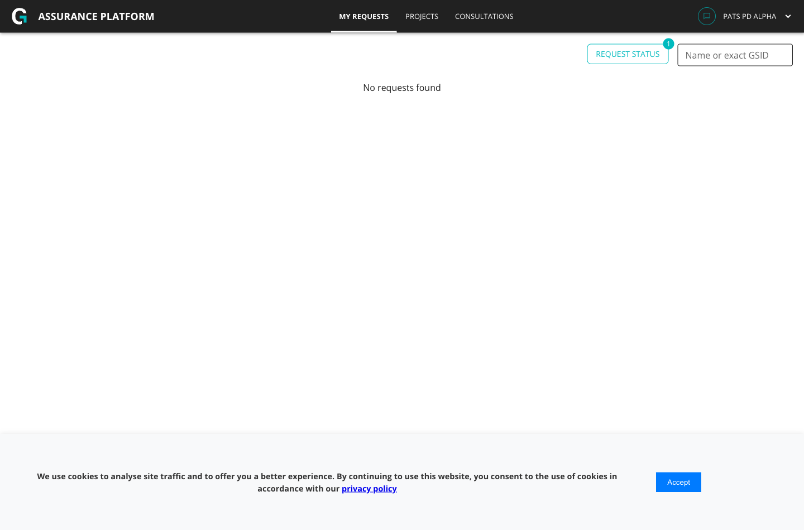

## Step 2: Open Create Project

Expected result: Alpha PD can enter the Create Project flow and see Step 1.

Evidence:

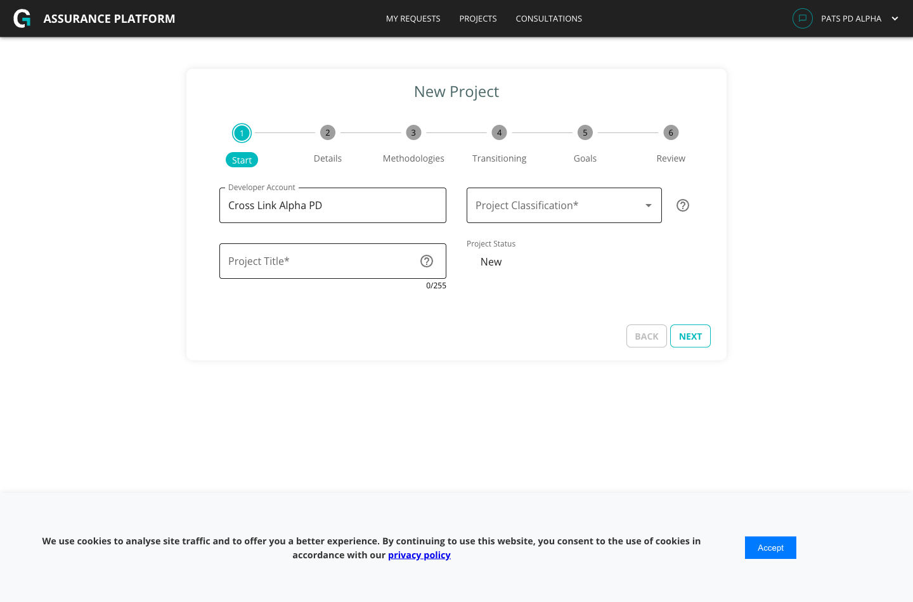

## Step 3: Verify Cross-Link Classifications Are Selectable

Expected result: the Project Classification dropdown includes both new Proposal 2 labels:

- `Real Case VPA (cross linkage)`
- `Regular Case VPA (cross linkage)`

Evidence:

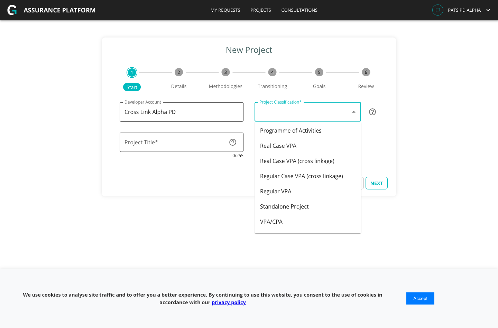

## Step 4: Verify Cross-Linkage Helper Note

Expected result: the Project Classification helper explains what cross linkage means, matching the email requirement.

Evidence:

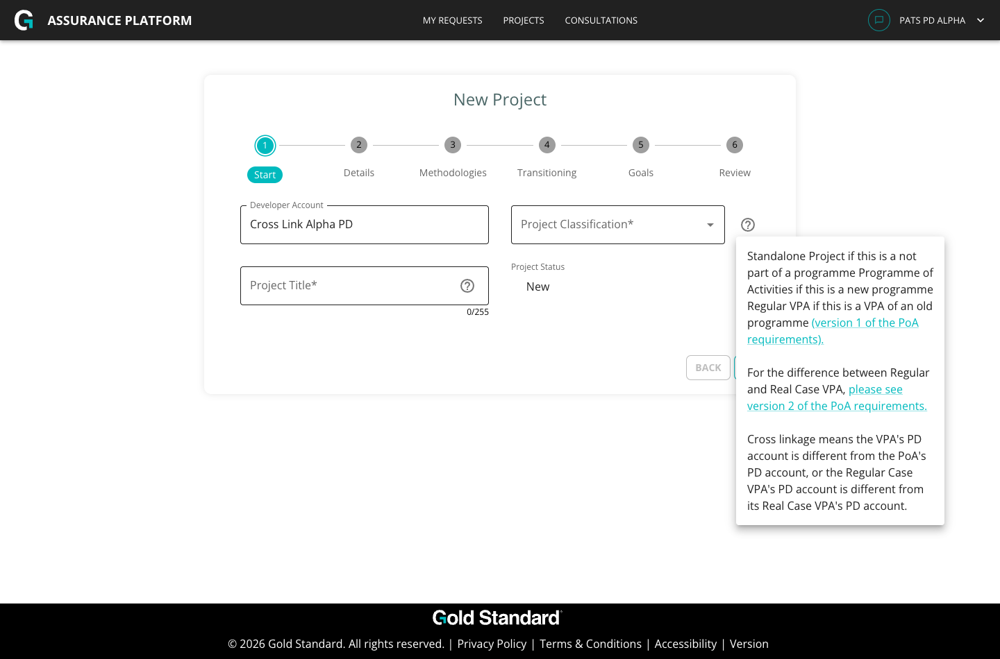

## Step 5: Verify Cross-Link Real Case VPA Shows PoA Only

Action: select `Real Case VPA (cross linkage)`.

Expected result: the wizard shows `Programme of Activities` and does not show a `Real Case VPA` selector.

Evidence:

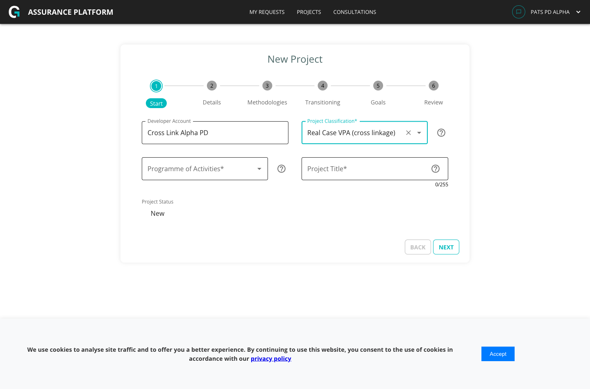

## Step 6: Verify Cross-Account PoA Options Across Statuses

Action: open the `Programme of Activities` dropdown for `Real Case VPA (cross linkage)`.

Expected result: Alpha PD can see Beta PD PoAs across statuses:

- `Cross Link Beta PoA - Design Certified (GS910103)`
- `Cross Link Beta PoA - Listed (GS910102)`
- `Cross Link Beta PoA - New (GS910101)`

Evidence:

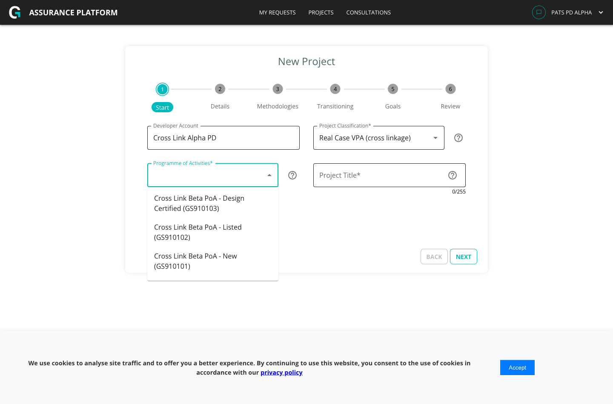

## Step 7: Verify Cross-Link Regular Case VPA Shows PoA And Real Case Selectors

Action: select `Regular Case VPA (cross linkage)`.

Expected result: the wizard shows both required selectors:

- `Programme of Activities`
- `Real Case VPA`

Evidence:

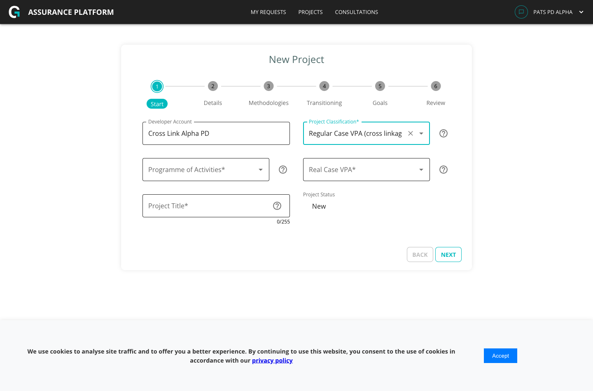

## Step 8: Verify Real Case VPA Options Are Filtered By Selected PoA

Action: select `Cross Link Beta PoA - Listed (GS910102)`, then open the `Real Case VPA` dropdown.

Expected result: the wizard lists Real Case VPAs under the selected PoA. In this seeded demo data, the matching option is:

- `Cross Link Beta Real Case - ACM0001 (GS910104)`

Evidence:

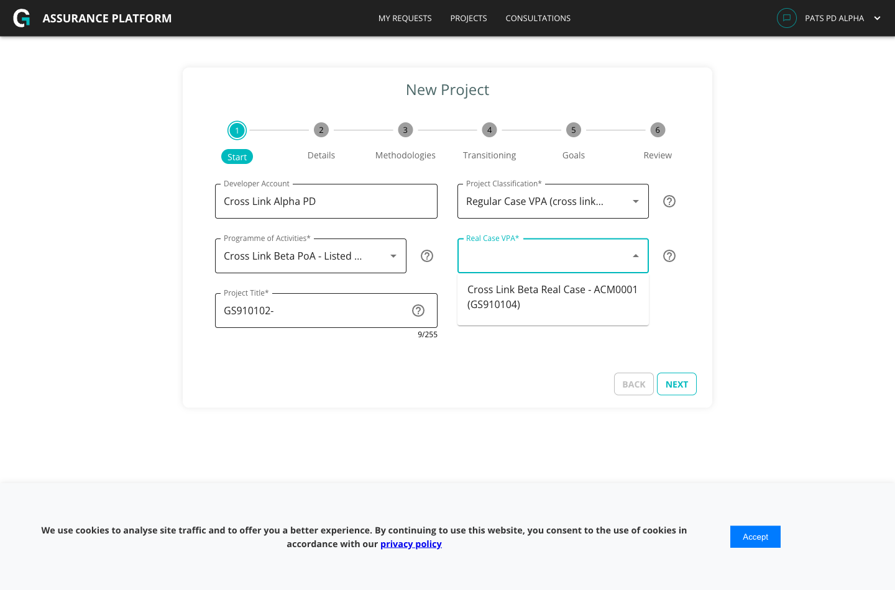

## Step 9: Submit Cross-Link Regular Case VPA Through The Wizard

Action: complete the React Create Project wizard for `Regular Case VPA (cross linkage)`, selecting:

- PoA: `Cross Link Beta PoA - Listed (GS910102)`
- Real Case VPA: `Cross Link Beta Real Case - ACM0001 (GS910104)`
- Methodology: `ACM0001 Flaring or use of landfill gas`
- Methodology version: `1`
- Transitioning Project: `No`
- Fee Schedule: `Cash per Credit`

Expected result: the Review step shows the normalized `Regular VPA` label. Clicking `Finish` redirects Alpha PD to `/project-trees` and shows the newly created `GS910108`.

Evidence:

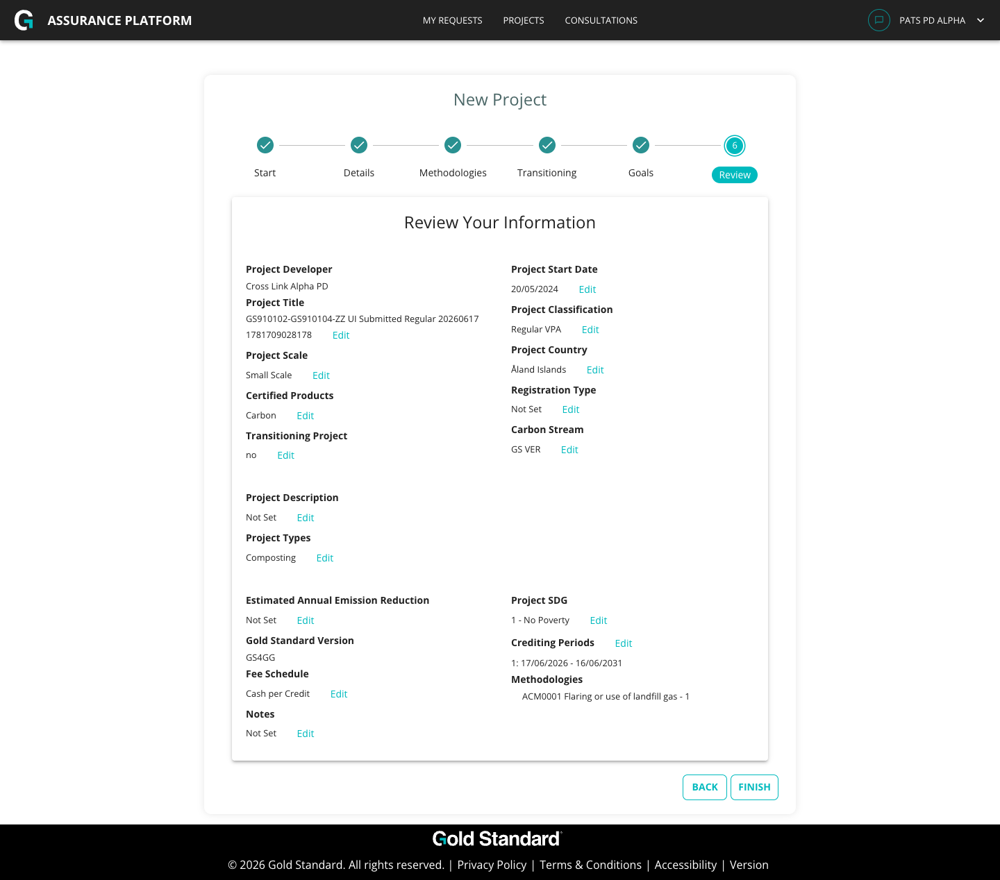

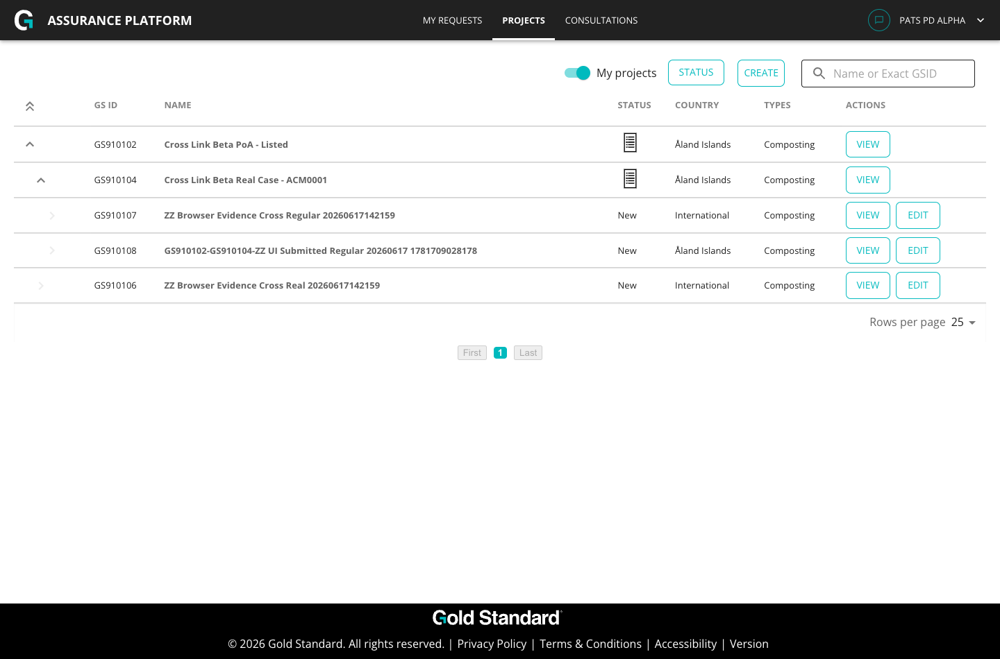

## Step 10: Submit Cross-Link Real Case VPA Through The Wizard

Action: complete the React Create Project wizard for `Real Case VPA (cross linkage)`, selecting:

- PoA: `Cross Link Beta PoA - Listed (GS910102)`
- Methodology: `ACM0001 Flaring or use of landfill gas`
- Methodology version: `1`
- Transitioning Project: `No`
- Fee Schedule: `Cash per Credit`

Expected result: the Review step shows the normalized `Real Case VPA` label. Clicking `Finish` redirects Alpha PD to `/project-trees` and shows the newly created `GS910109`.

Evidence:

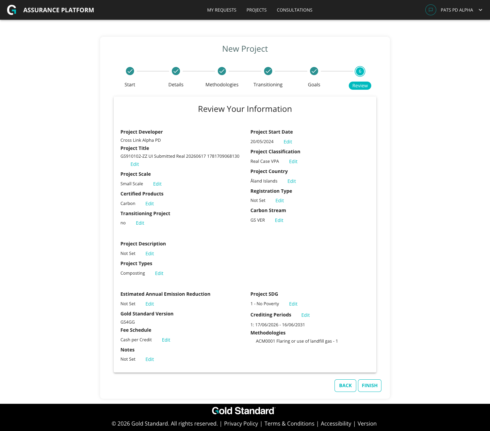

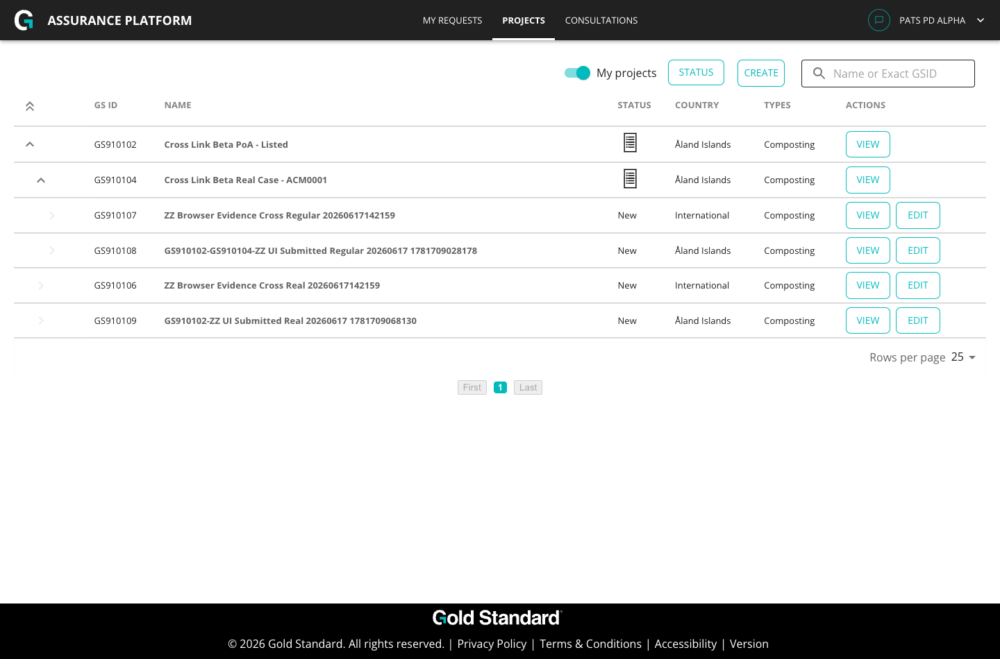

## Step 11: Verify Cross-Link Regular Detail Uses Normal Display Label

Action: open `GS910108`.

Expected result:

- Detail page is visible to Alpha PD.
- The project class displays as `Regular VPA`.
- The linked PoA GSID is `GS910102`.
- The raw `(cross linkage)` wording does not leak into the detail display.

Evidence:

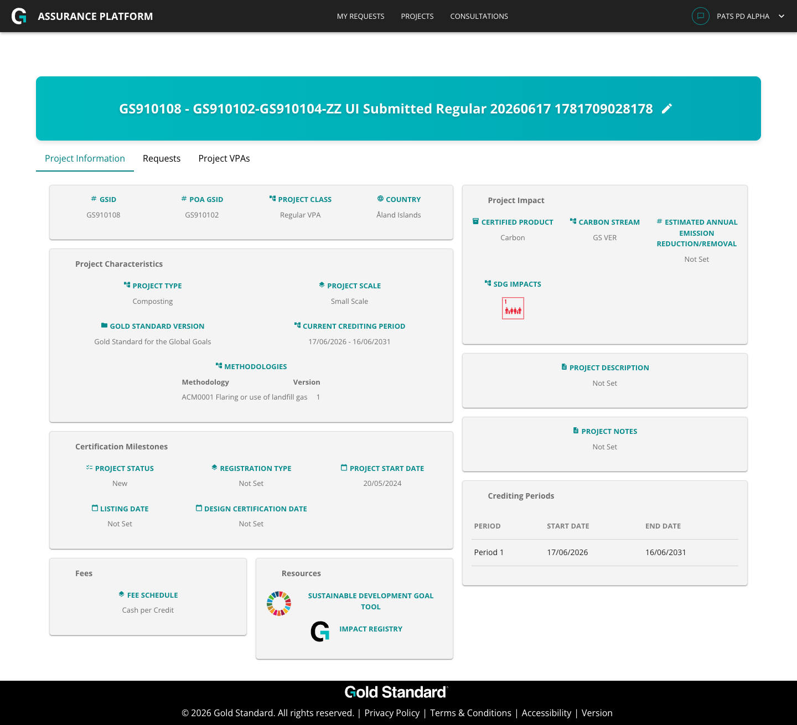

## Step 12: Verify Cross-Link Real Detail Uses Normal Display Label

Action: open `GS910109`.

Expected result:

- Detail page is visible to Alpha PD.
- The project class displays as `Real Case VPA`.
- The linked PoA GSID is `GS910102`.
- The raw `(cross linkage)` wording does not leak into the detail display.

Evidence:

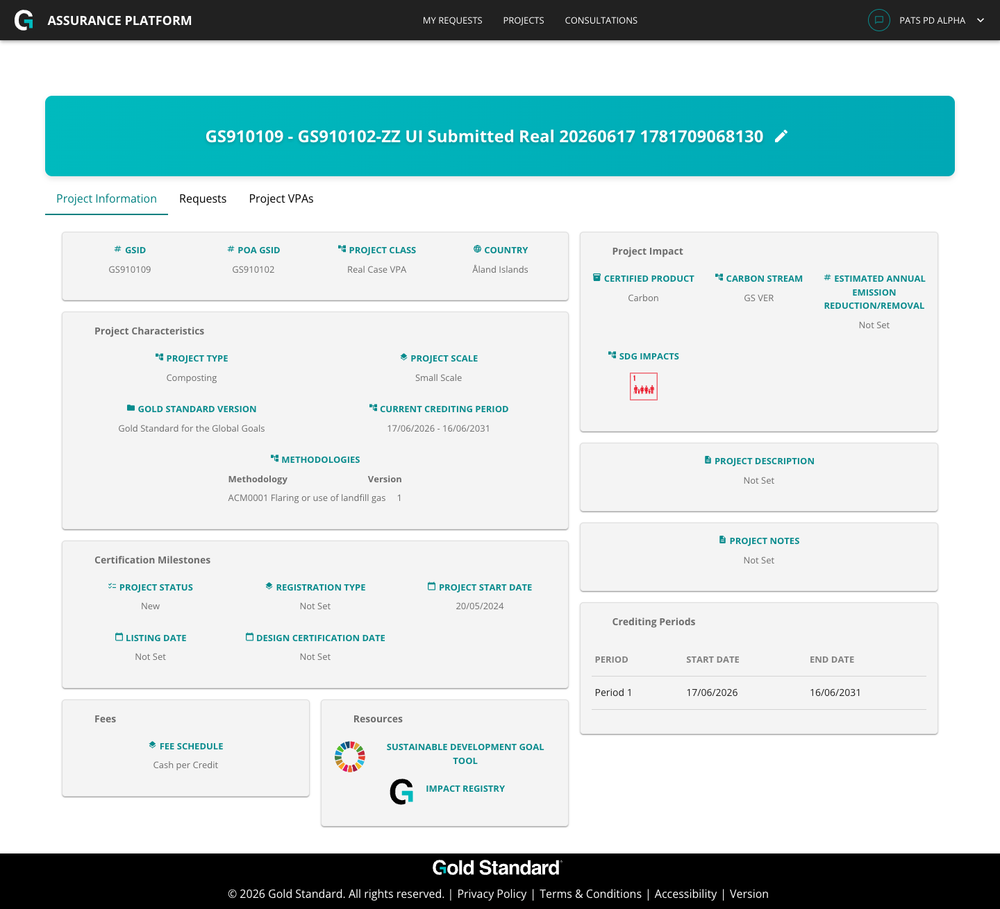

## Step 13: Verify Linked Parent PD Cannot Access The Created Cross-Link Child

Action: log in as Beta PD and directly open `http://localhost:3000/projects/GS910108`.

Expected result: Beta PD reaches the `NoAccess` page. This verifies the linked parent PD does not gain visibility or action access to Alpha's newly linked project.

Evidence:

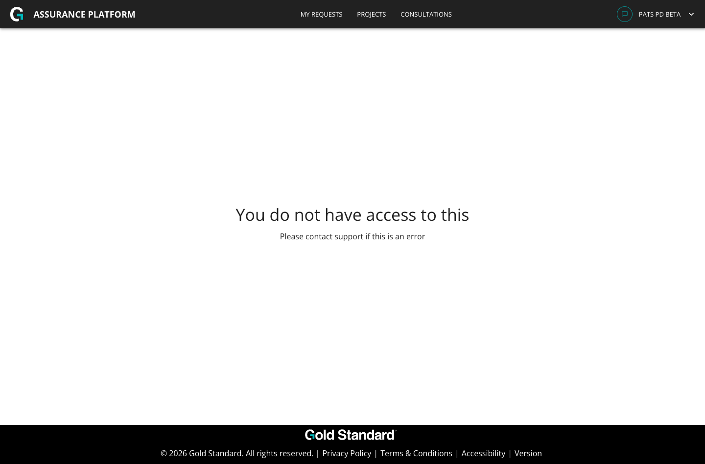

## Step 14: Create Request Rows For Dashboard Evidence

Action: as Alpha PD, open each UI-submitted project, go to `Requests`, click `Create New Request`, and finish a standalone request:

- `GS910108`: `Inclusion | Regular Case VPA`
- `GS910109`: `Design Certification | Real Case VPA`

Expected result: each project detail shows a current request.

Evidence:

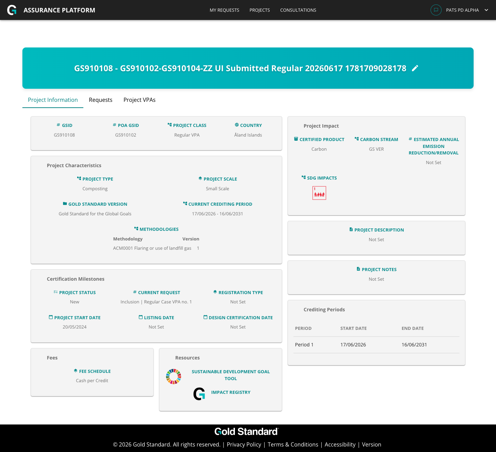

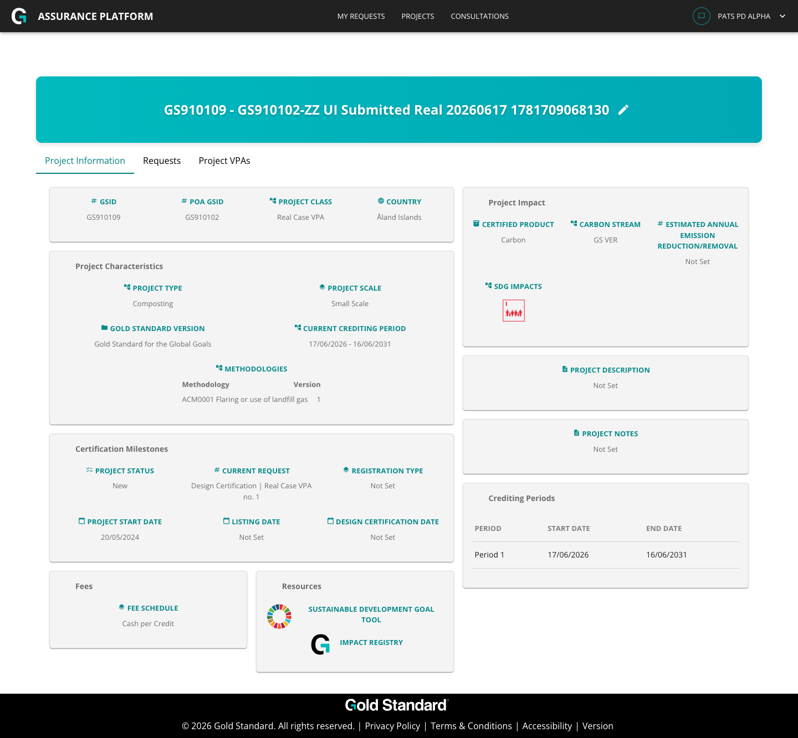

## Step 15: Verify Dashboard DTO Normalizes Cross-Link Labels

Action: as Admin, call the authenticated common-dashboard endpoint for the created request rows.

Expected result: the dashboard DTO returns both rows and normalizes the project classifications:

- `GS910108`: `Regular VPA`
- `GS910109`: `Real Case VPA`

Evidence:

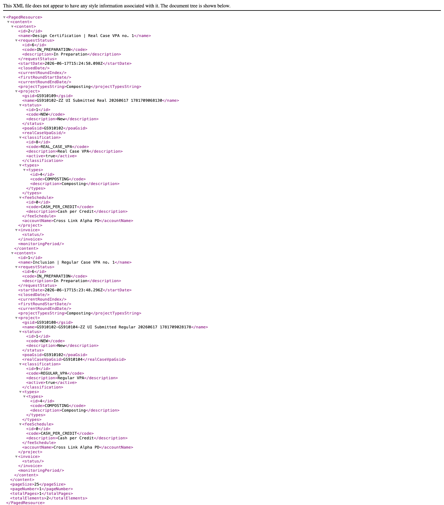

Note: the common dashboard page has a default `First RoR Start Date` filter for May 2026. These newly created `In Preparation` requests do not have a first-round start date yet, so the default table view shows no rows until that filter is cleared or the requests advance into a round.

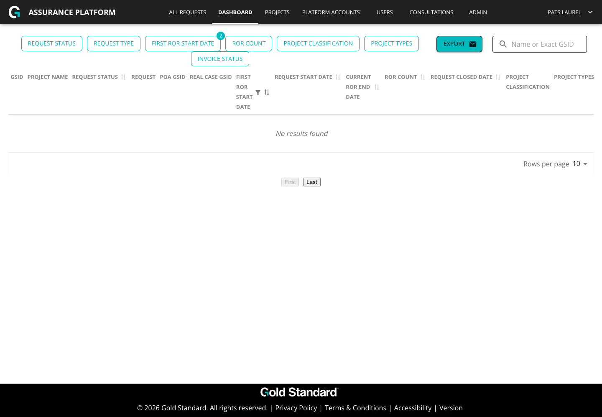

## Result Summary

| Requirement | Demo result | Evidence |
|---|---|---|
| New cross-link classifications are visible to PD users | Passed | `03-classification-options.png` |
| Cross-linkage explanatory note is visible | Passed | `03b-cross-linkage-helper-note.png` |
| Cross-link Real Case VPA selects PoA only | Passed | `04-real-cross-link-poa-only.png` |
| Cross-account PoAs appear across New, Listed, and Design Certified statuses | Passed | `05-real-cross-link-poa-options.png` |
| Cross-link Regular Case VPA selects PoA plus Real Case VPA | Passed | `06-regular-cross-link-selectors-empty.png`, `07-regular-cross-link-real-case-options.png` |
| Regular cross-link project is submitted through React wizard | Passed | `13-regular-ui-review-before-finish.png`, `14-regular-ui-submit-success-tree.png`; created `GS910108` |
| Real cross-link project is submitted through React wizard | Passed | `13-real-ui-review-before-finish.png`, `14-real-ui-submit-success-tree.png`; created `GS910109` |
| Created projects remain owned by creating PD and are visible in Alpha's authorized tree | Passed | `14-regular-ui-submit-success-tree.png`, `14-real-ui-submit-success-tree.png`; see `manifest.md` |
| Project details use normal Real/Regular labels | Passed | `15-regular-ui-submitted-detail.png`, `16-real-ui-submitted-detail.png` |
| Linked parent PD has no access to created child | Passed | `17-beta-ui-submitted-regular-access-denied.png` |
| Request rows are created through the React wizard | Passed | `20-regular-ui-request-created-detail.png`, `21-real-ui-request-created-detail.png`; request IDs `1`, `2` |
| Common dashboard DTO normalizes cross-link labels | Passed | `19-common-dashboard-api-normalized-rows.png` |

## Remaining Evidence Gaps

These are not blockers to the core local demo, but they are still useful for a stronger handoff:

- Clear or override the dashboard page's default `First RoR Start Date` filter, or advance the demo requests into a round, then capture the visible dashboard table rows. The authenticated dashboard DTO already shows normalized labels.
- Capture the generated spreadsheet artifact after the asynchronous common-dashboard export finishes. The export endpoint accepted the request with `202 Accepted`.
- Capture status-report evidence once the created requests advance into a reportable status/round, or explicitly record that `In Preparation` demo requests are not part of the status-report grouping yet.
- Capture an ARM browser screenshot showing edit access to the cross-link projects. Current evidence is backend-test based.

## Invalid Earlier Evidence

`08-invalid-alpha-global-projects-route-unauthorized.png` is intentionally retained as a warning artifact. Project Developer users are not authorized for the global `/projects` route, so that screenshot must not be used as passing evidence.
