# Proposal 2 Regression Fix Demo Walkthrough

## Demo Metadata

| Field | Value |
|---|---|
| Demo date | 2026-06-19 |
| Local app | `http://localhost:3000` |
| Backend | `http://localhost:8080` |
| Branch | `feat/proposal-2-cross-linking` |
| Regression plan | `docs/plan/proposal2-regression-fix-001/05-regression-test-and-demo-gates.md` |
| Prior full create walkthrough | `docs/mops/evidence/proposal2-cross-linking-demo/2026-06-17/demo-walkthrough.md` |
| Browser evidence | Chrome and Computer Use on local `localhost:3000`; screenshots saved in this folder. |

## What This Pass Proves

This pass focuses on the Proposal 2 regression gates added after the first demo:

- Admin can see the new cross-link classifications in the Projects list.
- ARM login works locally and ARM can open edit screens without losing existing edit parity.
- Alpha PD can see Alpha-owned cross-link child projects.
- Alpha PD can edit a New cross-link child only in the permitted scope: title/classification editable, linked parent protected.
- The edit-form classification label bug is fixed: selected cross-link values keep the `cross linkage` label.
- Beta PD, as the linked parent PD, cannot see or direct-open Alpha-owned cross-link child projects.

The end-to-end create wizard proof remains the 2026-06-17 demo walkthrough. In this 2026-06-19 pass, local data was reset and then current-run cross-link projects were seeded so the edit/access gates could be tested repeatedly without mutating the original seeded Beta PoA/Real Case fixtures.

Passwords and external credentials are intentionally not recorded.

## Demo Data

Seeded baseline after reset:

| GSID | Project | Owner | Classification | Status |
|---|---|---|---|---|
| `GS910101` | Cross Link Beta PoA - New | Cross Link Beta PD | Programme of Activities | New |
| `GS910102` | Cross Link Beta PoA - Listed | Cross Link Beta PD | Programme of Activities | Listed |
| `GS910103` | Cross Link Beta PoA - Design Certified | Cross Link Beta PD | Programme of Activities | Design Certified |
| `GS910104` | Cross Link Beta Real Case - ACM0001 | Cross Link Beta PD | Real Case VPA | Listed |
| `GS910105` | Cross Link Beta Real Case - ACM0002 | Cross Link Beta PD | Real Case VPA | Design Certified |

Current-run projects used for the regression demo:

| GSID | Project | Owner | Classification | Linked parent |
|---|---|---|---|---|
| `GS910106` | Demo Real Case VPA Cross Link - Current Run | Cross Link Alpha PD | Real Case VPA (cross linkage) | `GS910102` |
| `GS910107` | Demo Regular Case VPA Cross Link - Current Run | Cross Link Alpha PD | Regular Case VPA (cross linkage) | `GS910102` / `GS910104` |

## Automated Test Evidence

Frontend:

```bash
cd front-end
$HOME/.nvm/versions/node/v20.19.0/bin/node ./node_modules/jest/bin/jest.js --runTestsByPath \
  src/components/Project/create-project/steps/Step1.test.tsx \
  src/components/Project/update-project/UpdateProject.test.tsx \
  src/components/Project/project-list/ProjectList.test.tsx \
  --coverage=false \
  --maxWorkers=50%
```

Result: 3 suites passed, 35 tests passed.

Backend update/access:

```bash
cd back-end
/opt/homebrew/bin/mvn -Dtest=ProjectAccessPolicyTest,ProjectServiceTest,ProjectApiIntegrationTest test
```

Result: build success, 129 tests passed.

Backend dashboard/report/list labels:

```bash
cd back-end
/opt/homebrew/bin/mvn -Dtest=CommonDashboardConverterTest,DashboardRequestSpecFactoryTest,CommonDashboardReportRowPopulatorTest,StatusReportApiIntegrationTest test
```

Result: build success, 27 tests passed.

## Step 1: Admin Starts From The Seeded Baseline

Expected result: Admin can log in and reach the admin request area.

Evidence:

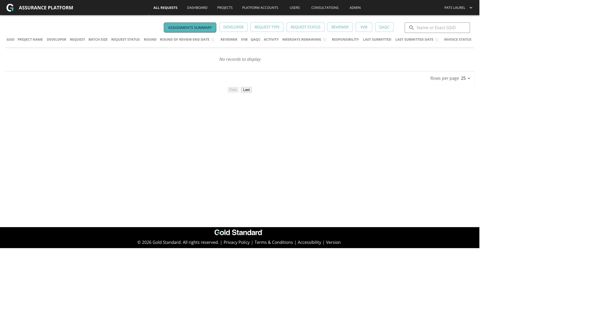

## Step 2: Admin Sees Seeded Projects

Expected result: Admin can access Projects and see the reset seeded Beta PoA/Real Case fixtures.

Evidence:

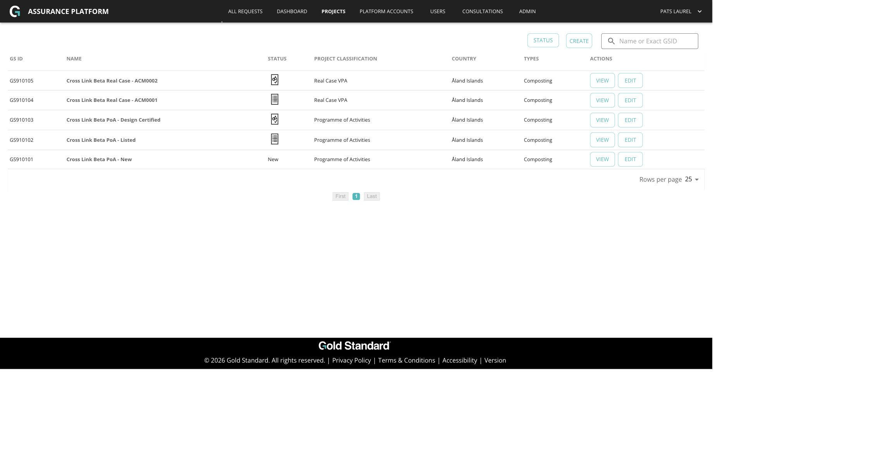

## Step 3: Admin Edit Fields Are Available For New Projects

Action: as Admin, open the seeded New PoA edit page.

Expected result: Admin can interact with account, classification, and title fields even while status is `New`.

Evidence:

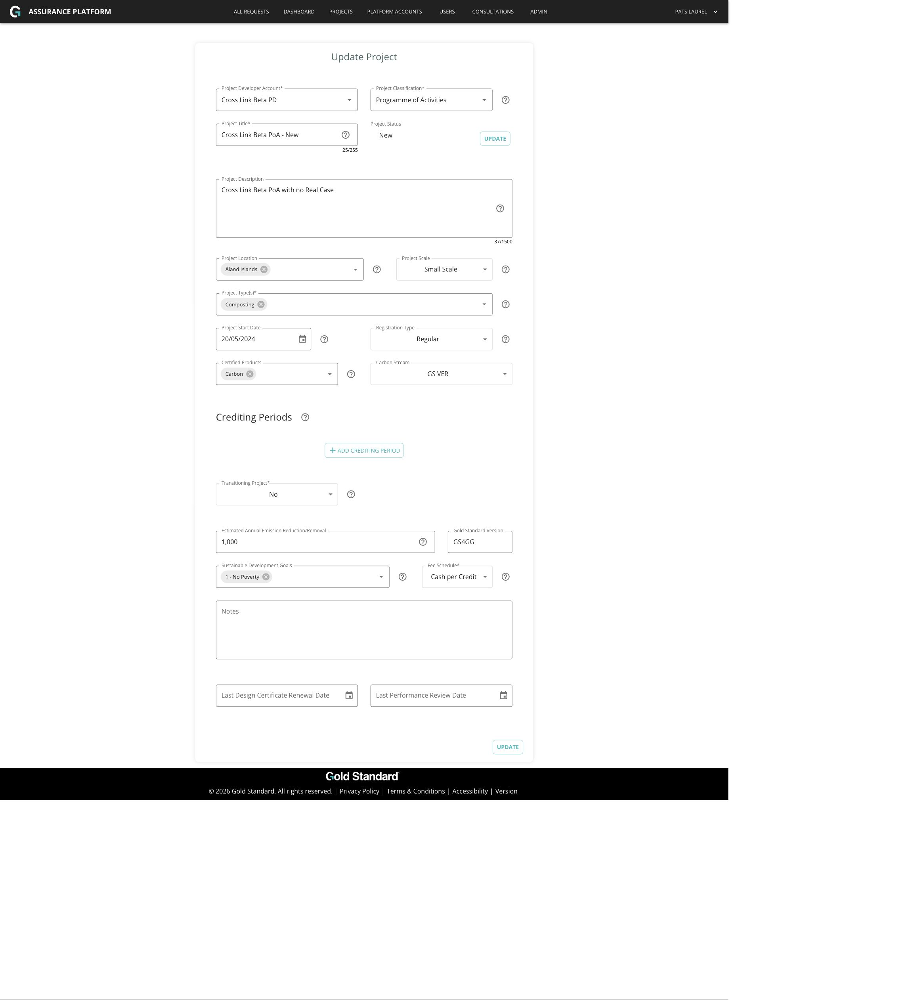

Note: the seeded New PoA fixture does not contain all of the form data required by the full update validator, so this screenshot proves field availability. Persisting updates was separately covered by the focused backend tests.

## Step 4: Admin Edit Fields Are Available For Listed Projects

Action: as Admin, open the seeded Listed Real Case VPA edit page.

Expected result: Admin can interact with account, classification, and title fields even after `New`.

Evidence:

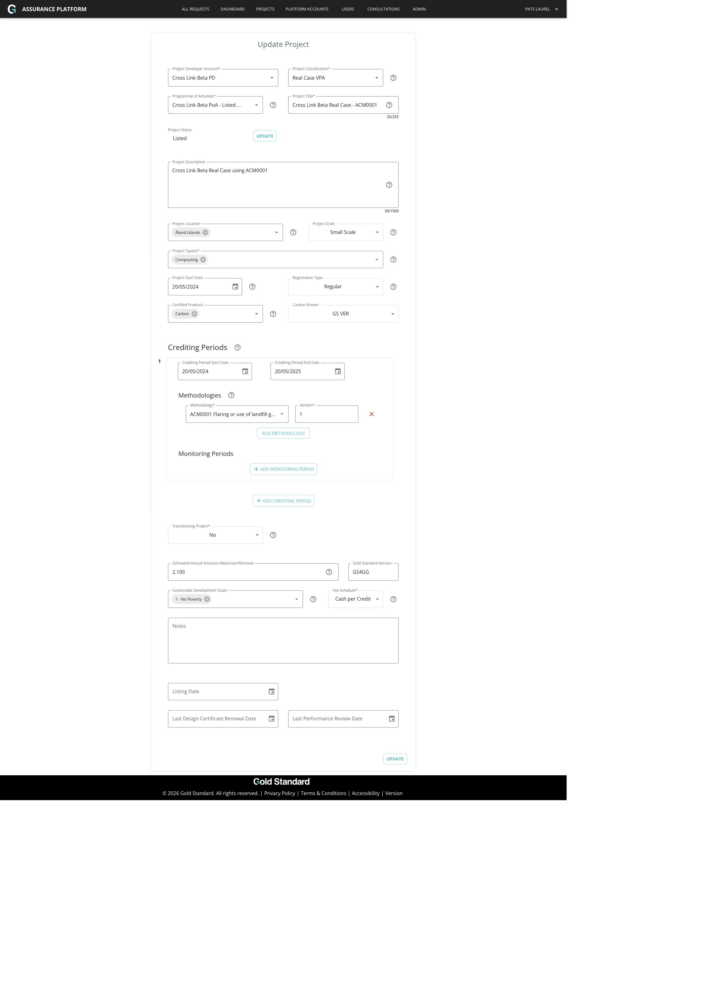

## Step 5: Admin Listed Title Update Persists

Action: as Admin, update the seeded Listed Real Case VPA title.

Expected result: after update, the project detail page shows the saved title.

Evidence:

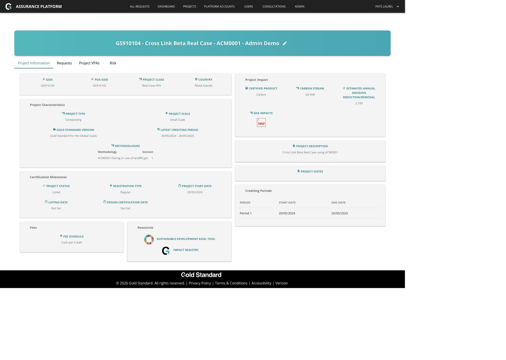

Note: the local data was reset again after this screenshot so the final demo baseline stayed clean.

## Step 6: ARM User Can Log In

Expected result: the local ARM account can authenticate and reach the app.

Evidence:

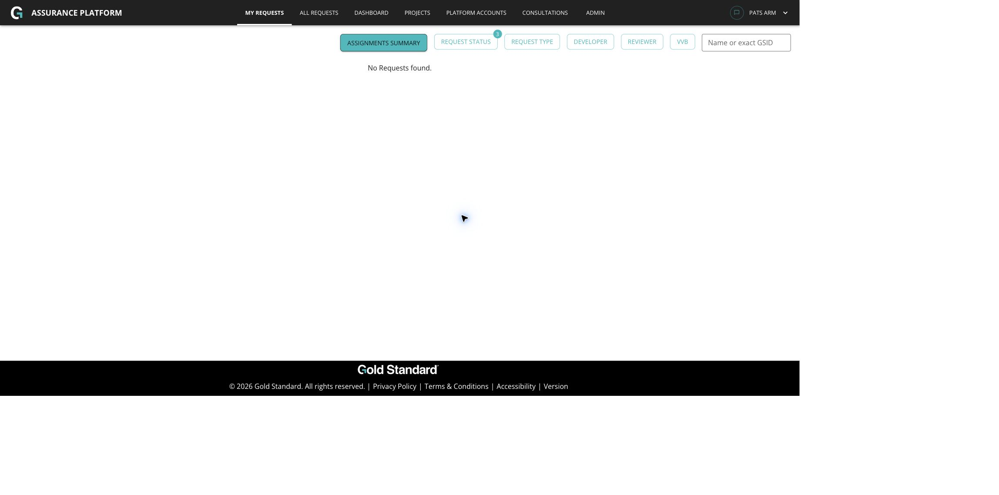

## Step 7: ARM Can Access Projects

Expected result: ARM can view the seeded project list.

Evidence:

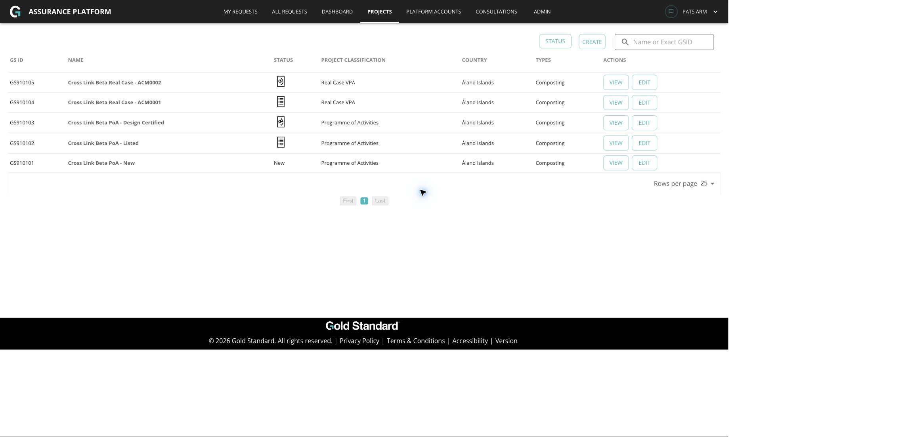

## Step 8: ARM Edit Parity Is Preserved

Action: as ARM, open the seeded Listed Real Case VPA edit page.

Expected result: ARM retains the existing ability to use the edit form for the same project surfaces covered by main parity.

Evidence:

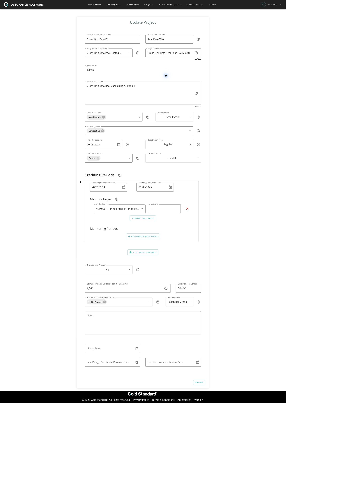

## Step 9: Alpha PD Can Log In

Expected result: Alpha PD can authenticate and reach the app.

Evidence:

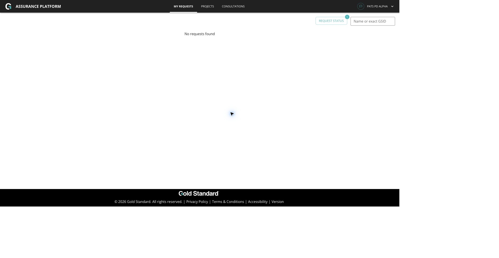

## Step 10: Alpha PD Sees Alpha-Owned Cross-Link Children

Expected result: Alpha PD can see the Alpha-owned current-run cross-link child projects in the project tree.

Evidence:

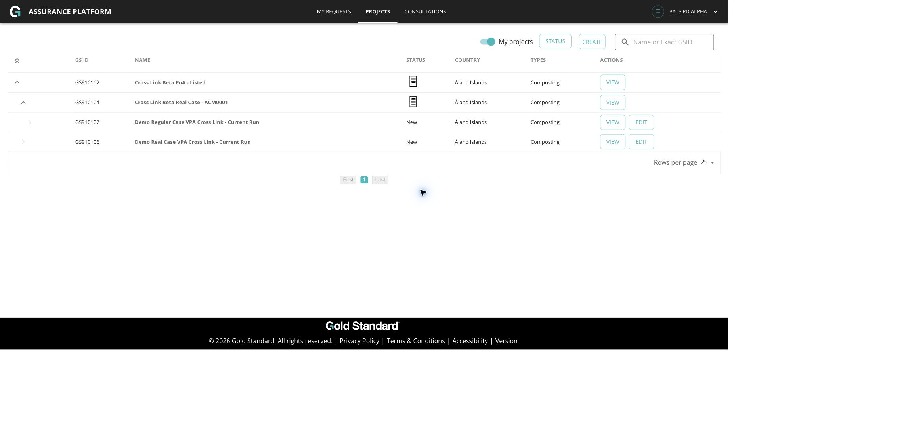

## Step 11: Alpha PD New Edit Scope Is Correct

Action: as Alpha PD, open the New Real Case VPA cross-link child for edit.

Expected result:

- Project title is editable.
- Project classification is editable.
- Developer Account is not editable.
- Linked `Programme of Activities` is protected.
- Status remains `New`.

Evidence:

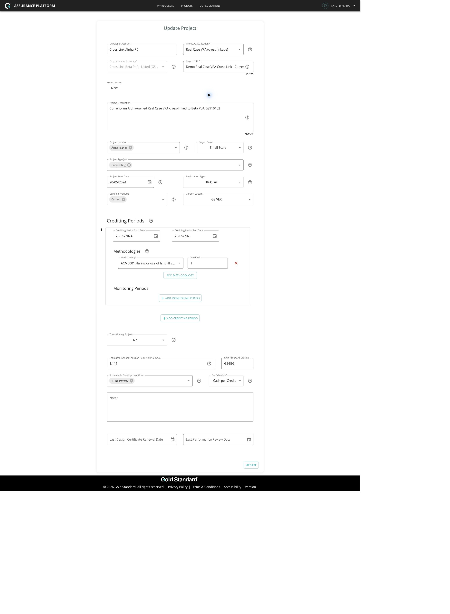

## Step 12: Cross-Link Labels Stay Visible In Edit Dropdowns

Action: open the `Project Classification` dropdown while editing the cross-link child.

Expected result: selected and selectable cross-link classifications preserve their cross-link wording:

- `Real Case VPA (cross linkage)`
- `Regular Case VPA (cross linkage)`

Evidence:

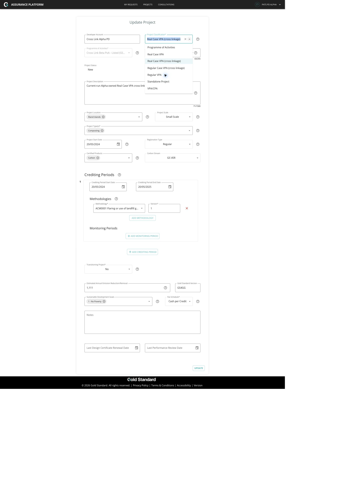

This addresses the feedback where selected cross-link classifications previously collapsed to `Real Case VPA` or `Regular VPA` on edit.

## Step 13: Beta PD Cannot Direct-Open Alpha Cross-Link Child

Action: log in as Beta PD and direct-open `http://localhost:3000/projects/GS910106`.

Expected result: Beta PD reaches `NoAccess`.

Evidence:

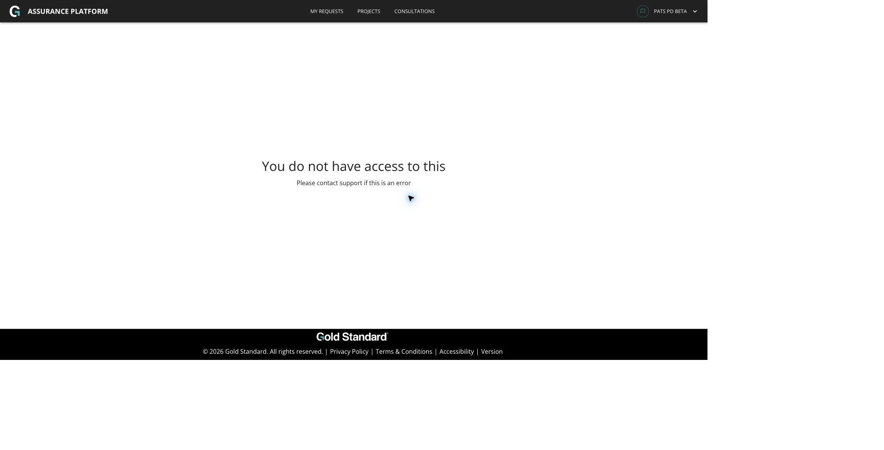

## Step 14: Beta PD Cannot See Alpha Cross-Link Children In Project Tree

Expected result: Beta PD only sees Beta-owned seeded projects; Alpha-owned `GS910106` and `GS910107` are absent.

Evidence:

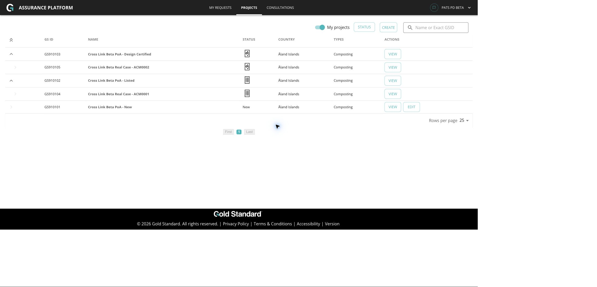

## Step 15: Admin Can See Current-Run Cross-Link Projects And Labels

Expected result: Admin Projects list includes the current-run cross-link projects with the correct cross-link labels and Edit actions.

Evidence:

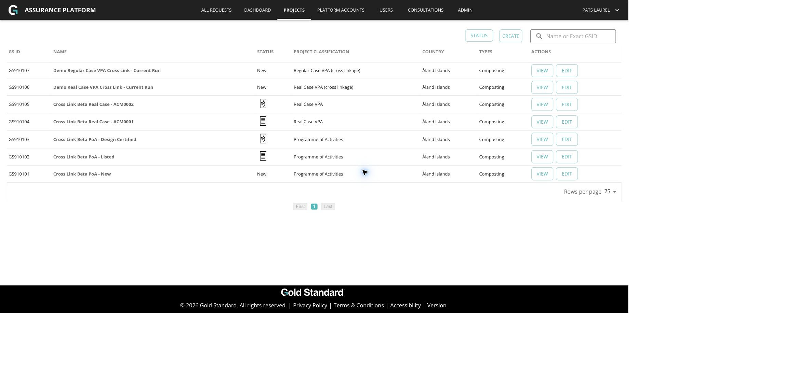

## Result Matrix

| Requirement | Result | Evidence |
|---|---|---|
| Admin can edit New project fields | Passed for UI field availability; persistence covered by backend tests | `03-admin-edit-new-fields-enabled.png`, backend tests |
| Admin can edit Listed or later project fields | Passed | `04-admin-edit-listed-fields-enabled.png`, `05-admin-listed-title-update-persisted-detail.png` |
| ARM local user works | Passed | `06-arm-login-my-requests.png` |
| ARM edit parity preserved | Passed for browser field availability; backend parity covered by tests | `08-arm-edit-listed-fields-enabled.png`, backend tests |
| PD can edit own New project title/classification | Passed | `11-alpha-pd-new-edit-cross-link-label-and-protected-parent.png` |
| PD cannot edit own New project account/parents | Passed | `11-alpha-pd-new-edit-cross-link-label-and-protected-parent.png` |
| Cross-link labels remain visible in edit dropdowns | Passed | `12-alpha-edit-classification-dropdown-cross-link-labels.png`, frontend tests |
| Linked parent PD cannot direct-open child | Passed | `13-beta-direct-open-alpha-cross-link-denied.png` |
| Linked parent PD cannot list/tree-view child | Passed | `14-beta-project-tree-no-alpha-cross-links.png` |
| Admin can search/list cross-link projects | Passed | `15-admin-projects-current-run-cross-links.png` |
| Full create wizard Real Case VPA cross-link | Previously passed; not re-run in this 2026-06-19 browser pass | `../2026-06-17/demo-walkthrough.md` |
| Full create wizard Regular Case VPA cross-link | Previously passed; not re-run in this 2026-06-19 browser pass | `../2026-06-17/demo-walkthrough.md` |
| Dashboard/report/export current-run browser proof | Automated coverage passed; browser evidence not recreated in this pass | Backend dashboard/report tests |

## Remaining Demo Gaps

Before recording a client-facing video, decide whether you need these as live browser steps in the same recording:

1. Re-submit the full create wizard flow again after reset instead of relying on the 2026-06-17 UI evidence.
2. Create request rows for the current-run projects and capture the dashboard/status-report/export screens again.
3. Demonstrate Admin persistence on a New project that has a complete update payload, or use a fixture specifically shaped for update validation.

The important edit/access regressions from the 2026-06-18 plan are covered by this pass plus the focused tests.
